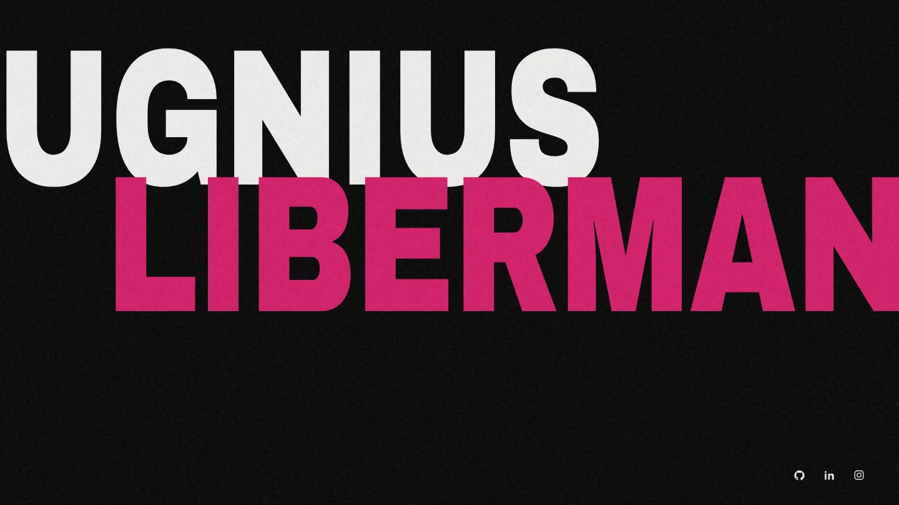

# ugniusk-web



The portfolio and journal of Ugnius Liberman, a designer and developer creating thoughtful digital
experiences. A fully static Astro build with no client-side framework - the motion layer is written
by hand, and the site ships no runtime dependencies beyond it.

## Stack

| | |
| --- | --- |
| Framework | Astro 6, static output |
| Styling | Tailwind CSS v4, wired in through `@tailwindcss/vite` |
| Motion | Lenis for scroll, Anime.js for reveals, a custom blend-mode cursor and a text-scramble effect in plain TypeScript |
| Type | Archivo Black and Roboto Condensed, loaded from Google Fonts |
| Language | TypeScript end to end |
| Deploy | Vercel - security headers in `vercel.json`, Web Analytics and Speed Insights loaded through Vercel's first-party scripts rather than npm packages |

## Getting started

```sh
npm install
npm run dev        # http://localhost:4321
```

| Command | Does |
| --- | --- |
| `npm run dev` | Dev server on `:4321` |
| `npm run build` | Static build to `dist/` |
| `npm run check` | Astro and TypeScript diagnostics |
| `npm run preview` | Serve the built `dist/` locally |

Node 22.12 or newer.

## Where things live

```text
src/
├─ pages/         routes - the index and projects/[slug]
├─ layouts/       BaseLayout: metadata, fonts, shared head
├─ components/    one file per section - Hero, ProjectCarousel, ProjectDetail, …
├─ data/          site.ts and projects.ts - all copy and project content
├─ scripts/       client-side motion: scroll, cursor, scramble, nav
└─ styles/        global.css - design tokens and shared rules
```

## Editing content

Every project is one entry in a typed array in `src/data/projects.ts`. An entry carries its own
metadata, copy and visuals, and two optional flags change how it is treated:

- `hidden: true` - keeps the entry in the data but removes it from the site entirely: no card, no
  page, no sitemap entry.
- `noPage: true` - shows the card without linking through to a project page.

An entry with no `image` or `gallery` renders a placeholder built from its `code`, so a project page
can ship before its screenshots exist.

## Notes

- Production builds set `assetsInlineLimit: 0`, so every script is emitted as an external file. That
  is what lets the CSP stay at `script-src 'self'` without inline hashes.
- `design-references/` is local-only working material and is gitignored - a fresh clone will not
  have it.
- There is no server, no API and no runtime data fetching. The build is static pages and static
  assets.
